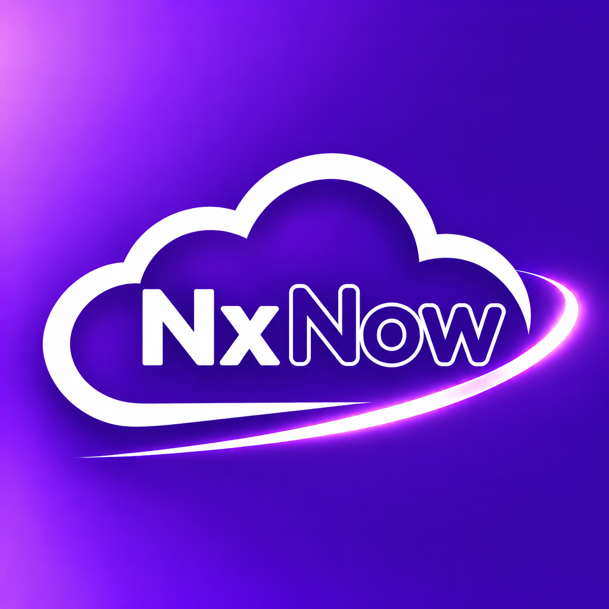
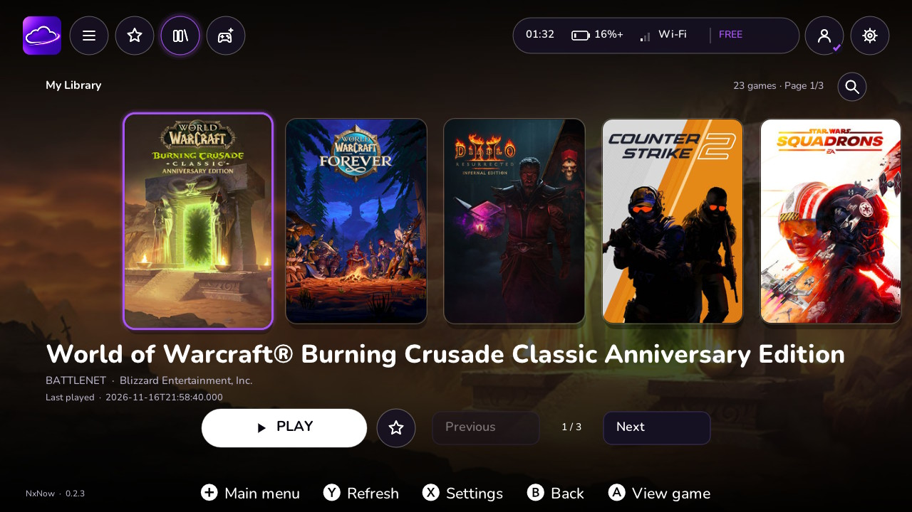
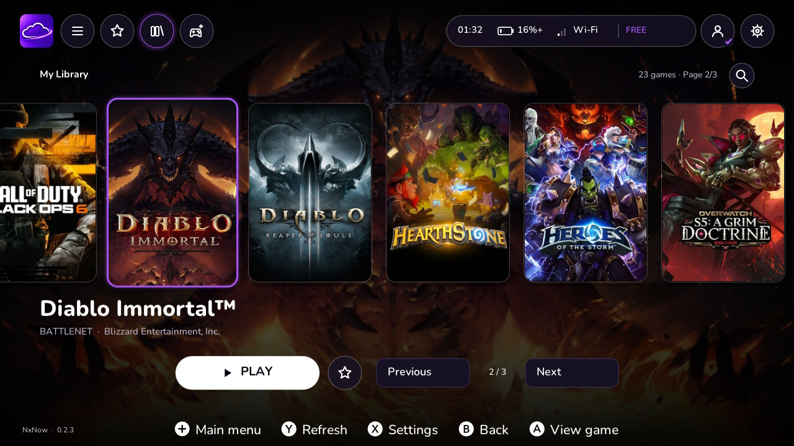
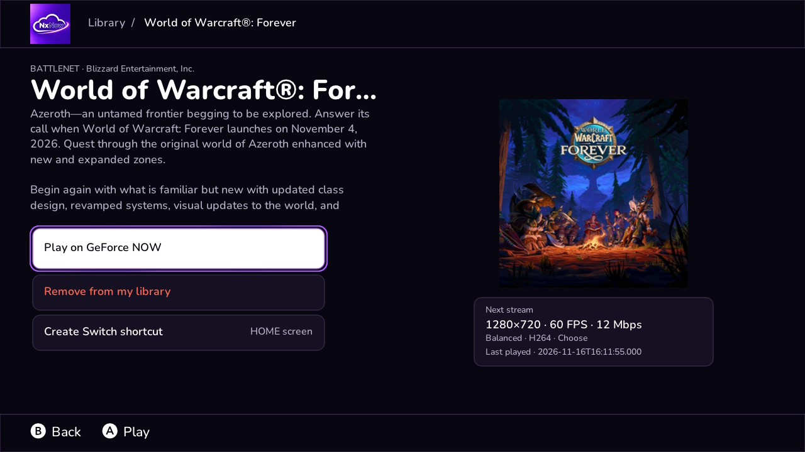
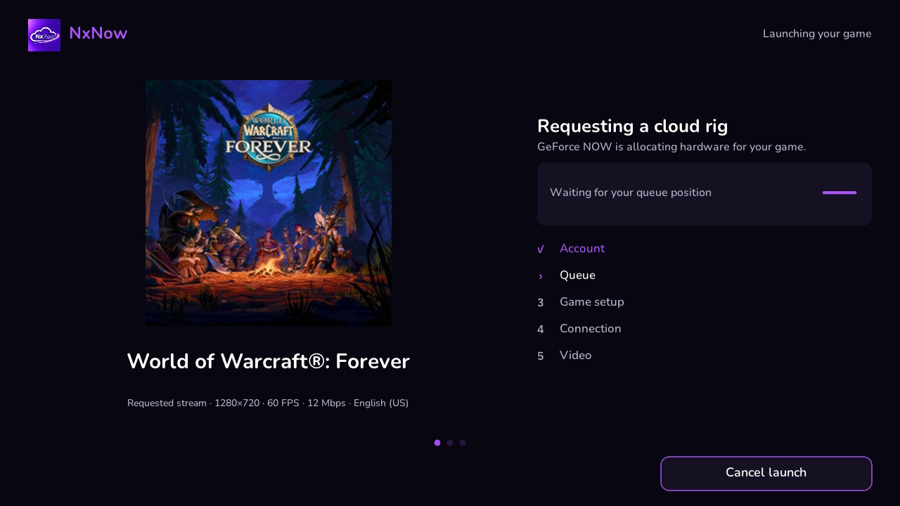
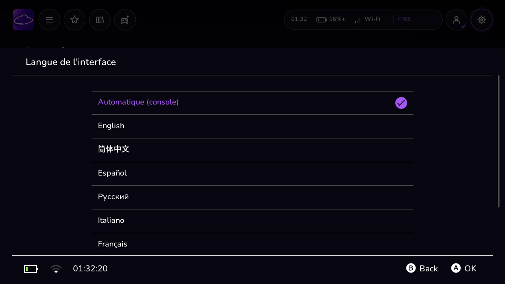
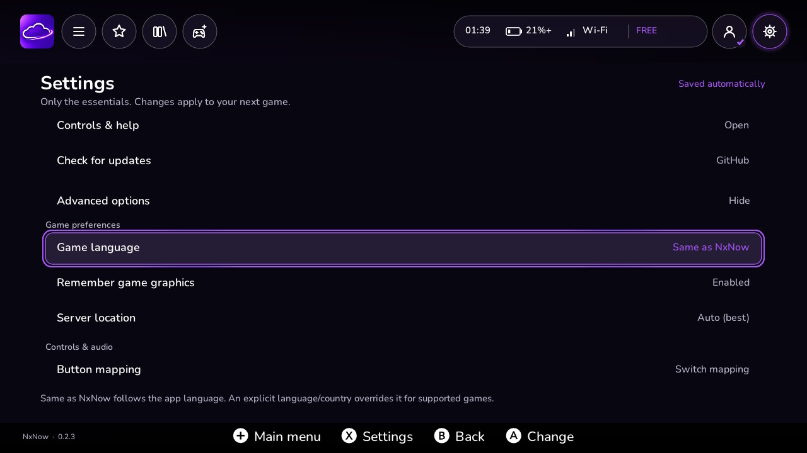
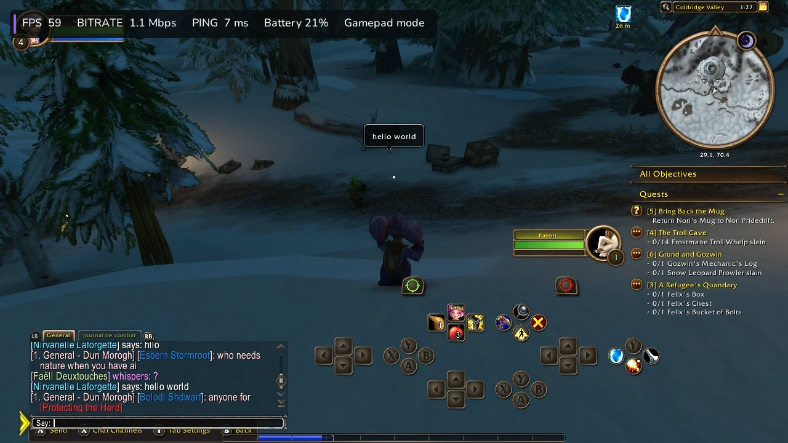
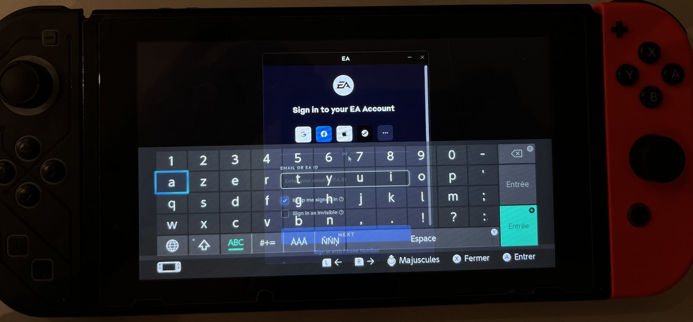
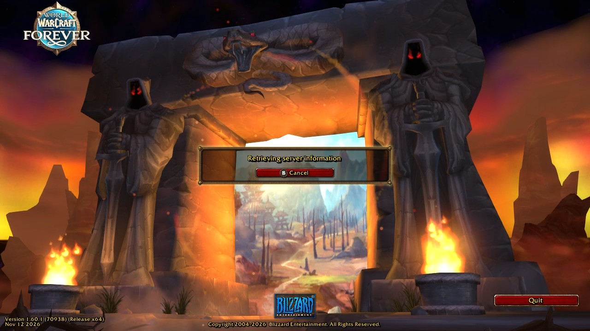

# V0.2e NxNow

### Your PC games. Your Nintendo Switch. Anywhere.

**A fresh way to enjoy GeForce NOW on Nintendo Switch.**

**The best way to play WoW Forever on Nintendo Switch right now! Have fun!**

Beautiful design · Multilingual experience · Controller-first navigation · Cloud gaming on the go

[**Download NxNow**](https://github.com/kazar-root/NxNow/releases) · [**Report an issue**](https://github.com/kazar-root/NxNow/issues) · [**Discover LunaNX**](https://github.com/kazar-root/LunaNX)

---

## What's new in v0.2e

A small visual update with a **new logo for the application** and a clearer launch screen.

- **New NxNow V3 app icon.** Used in hbmenu, at startup, during loading and as the temporary image placeholder. The GitHub page now uses the same logo.
- **Consistent cloud branding.** The cloud-only **NxNow Externe** logo appears in the app headers, including game details, game launch, sign-in and stream status. **NxNow is written in white** beside the logo in the menu, details, launch and stream-status headers.
- **A more compact menu logo.** Its 54 × 54 size matches the navigation buttons.
- **Long game titles stay in their space.** Launch titles use at most two lines, with a smaller font when needed and an ellipsis for exceptionally long names, keeping the instructions and cancel button clear.
- **New screenshots from a real Switch.** See the updated library, game launch, in-game chat, performance HUD, language selection and settings below.

All the keyboard and streaming improvements from v0.2d are included. **The application and hbmenu identify this release as 0.2.4.**

## What's new in v0.2d

This update fixes the problems reported by players after v0.2c. **Thank you all for your valuable feedback and your precious help!**

- **Battle.net sign-in works with the on-screen keyboard.** In Mouse & Keyboard Mode, **ZR + R3** now opens a plain keyboard. It no longer submits the empty email or password form on its own. See the [FAQ](FAQ.md) for the step-by-step sign-in guide.
- **No more "controller disconnected" messages when typing.** Opening or closing the keyboard no longer makes games think the controller was unplugged. This removes Diablo IV's *"Please reconnect your controller"* and World of Warcraft's *Xbox 360 Controller / Input controller #1 connected/disconnected* chat messages.
- **ZR + R3 also closes the keyboard.** Press the same shortcut again to close it. What you have already typed stays in the text field.
- **Sharp pictures for games added from the catalog.** Their library background is now loaded in high definition, and their vertical cover fills the whole card in the library.
- **Catalog and Library buttons** at the top of the screen no longer touch each other.

> **Have fun, everyone!**

## What's new in v0.2c

- **Even more stable streaming, especially in demanding games such as Counter-Strike 2.** NxNow now absorbs the large bursts of data that heavy scenes send at once, instead of losing part of them over Wi-Fi.
- **Much better 60 FPS.** Pictures are no longer skipped in pairs when they arrive slightly bunched up, which removes the judder and the apparent FPS drops at 60 FPS.
- **Smarter recovery from lost packets.** When a packet goes missing, NxNow waits just long enough for GeForce NOW to resend it (based on your measured connection delay) instead of freezing the picture. There is no extra delay when nothing is lost.
- **New *Diagnostics* option** in Settings › Controls & audio, to save a detailed stream log when reporting a problem.

> **Recommended settings:** a maximum bitrate of **20 Mbps** gives the best balance of image quality and stability, at 30 or 60 FPS. On Wi-Fi, stay close to your router and prefer 5 GHz.

## What's new in v0.2b

- **Most popular games.** The catalog has a new *Most popular games* view, ranked by GeForce NOW's own popularity ranking (sign-in required). Also available from the main menu.
- **Add or remove games from your library.** The page of any game in your library now offers *Remove from my library*, next to *I own this game* in the catalog. Games you added in NxNow are deleted; games from your GeForce NOW account are hidden in NxNow and can be added back from the catalog at any time.
- **Fully working on-screen keyboard.** Every character, including digits, symbols and accents, now arrives exactly as typed in chats and text fields. NxNow automatically follows your console's keyboard layout (AZERTY, QWERTY, QWERTZ…) and sets the cloud PC to match.
- **Smoother audio and video streams.** Improved handling of the audio and video streams: the picture now catches up instantly after a network or decoding hiccup, so fast-paced games such as Counter-Strike 2 stay responsive.
- **Faster catalog browsing.** Game thumbnails you have already seen show up instantly, using a small, strictly limited amount of memory.
- **Purple and white paging buttons** that match the NxNow look.

> If the stream still stutters and the sound crackles, check your Wi-Fi first: get closer to your router and prefer 5 GHz.

---

## Meet NxNow

**NxNow brings your GeForce NOW gaming experience to Nintendo Switch.** Play compatible PC games from your connected library through an unofficial homebrew client, with an interface carefully designed for the console.

I wanted NxNow to feel like more than a streaming launcher. That's why I've put particular care into the details: a distinctive purple visual identity, smooth controller-friendly navigation, rich game artwork, useful in-game controls, and thoughtful touches throughout the experience. **My goal is simple: give you a cloud gaming experience that feels unique, intuitive, and genuinely enjoyable to use.**

Whether you're exploring your library, launching a game, waiting for a server, or playing, I hope the design and attention to detail will make you smile.

## Why you'll love it

- **Designed for Switch.** A native, purple-themed interface tailored to the console's 720p display, with rich game covers and a clean layout.
- **Multilingual by design.** Console-language-aware UI, including French translation, with localized game descriptions when available from GeForce NOW.
- **Your games in one place.** Browse your GeForce NOW library and catalog, search for titles, organize favorites, and select supported storefronts or launchers.
- **A more personal experience.** Discover free-to-play titles, explore game details, and fine-tune your streaming profile, audio, server, and controls.
- **Made for real gameplay.** Gamepad support, a controller-based mouse and keyboard mode, a Switch virtual keyboard, and USB keyboard/mouse support where available.
- **Helpful little details.** A streamlined sign-in flow using a QR code, animated loading screens, a clear queue experience, and an optional in-game performance HUD.
- **Quick access.** Create a HOME menu shortcut for a game using the built-in shortcut feature, subject to its installation requirements.

**Compatible titles can include games launched through Steam, EA, Battle.net, and other GeForce NOW-supported services.** Game access still depends on your account, game ownership or entitlement, region, and GeForce NOW availability.

## Screenshots

Original captures from a Nintendo Switch, showing the new design and existing gameplay tools. These captures were taken on 0.2.3, before the final v0.2e header-logo and white-label adjustments.

<table>
<tr>
<td align="center"> <strong>Your library and the new cloud logo</strong></td>
<td align="center"> <strong>Browse games, favorites and library pages</strong></td>
</tr>
<tr>
<td align="center"> <strong>Game details and your next streaming profile</strong></td>
<td align="center"> <strong>Follow the cloud-rig launch and connection</strong></td>
</tr>
<tr>
<td align="center"> <strong>Choose the interface language</strong></td>
<td align="center"> <strong>Adjust game preferences and controls</strong></td>
</tr>
</table>

### Type in games and keep an eye on performance

Type in a game's chat or text fields with the Switch virtual keyboard. **ZR + R3** opens or closes it; **L3 + R3** switches between gamepad and mouse/keyboard modes. Press **− and + together** to show or hide the performance HUD with FPS, bitrate, ping, battery level and the current input mode.

The same keyboard can be used in supported launcher sign-in fields. In mouse/keyboard mode, select the field with the left stick and ZR, then open the keyboard with **ZR + R3**. See the [FAQ & Tips](FAQ.md) for the complete guide.

### From the library to gameplay

### Performance settings and languages

Choose your streaming profile in **Settings** or from a game's **Next stream** panel. Advanced options let you adjust resolution, frame rate, bitrate, codec and server location. Settings are saved automatically and apply to your next game session.

The interface supports **English, Simplified Chinese, Spanish, Russian, Italian, French, Polish and Ukrainian**, plus automatic selection from your console language. The separate **Game language** preference can follow NxNow or request another supported language; availability depends on the game and GeForce NOW.

## Get started

1. Download **`NxNow.nro`** or the SD package from the [latest Releases](https://github.com/kazar-root/NxNow/releases).
2. Copy `NxNow.nro` to `sdmc:/switch/NXNow/NxNow.nro`.
3. Launch **hbmenu in application mode** (hold **R** while launching an installed game), then open NxNow. Application mode provides the memory needed for streaming.
4. Connect your Switch to the internet. Select the profile icon in NxNow and scan the QR code using your phone to sign in to NVIDIA.
5. Explore your library or the GeForce NOW catalog, select the appropriate storefront for games you own, and start playing.

NxNow keeps its account-related local data and settings in `sdmc:/switch/NXNow/`. To update, replace the NRO while preserving that folder.

By default, NxNow follows your console language for its interface and requests the same language from GeForce NOW when launching a game. A manual language choice takes priority; the game must support the requested language and may retain its own language settings.

### In-game shortcuts

| Controls | Action |
| --- | --- |
| **L3 + R3** | Switch between gamepad and mouse/keyboard modes |
| **ZR + R3** | Open or close the virtual keyboard |
| **− and +** | Show or hide the streaming performance HUD |
| **Left stick** (mouse mode) | Move the pointer |
| **ZR / ZL** (mouse mode) | Left / right click |
| **D-pad** (mouse mode) | Keyboard arrow keys |
| **−** (mouse mode) | Escape |

ℹ️ Questions about sign-in, keyboards, 60 FPS or connection tips? See the **[FAQ & Tips](FAQ.md)**.

## A project made with passion

NxNow is an independent community project, created by **[KazaR-RooT](https://github.com/kazar-root)**. This is an early release, and your feedback can help make it even better. If you enjoy the app, consider leaving a ⭐ on GitHub or sharing your experience!

Found a bug or have a suggestion? [Open an issue](https://github.com/kazar-root/NxNow/issues). Please include your NxNow version, game, storefront, and steps to reproduce, but never share passwords, access tokens, session files, or console keys.

## Another project: LunaNX 🌙

If you like NxNow, you might also enjoy **[LunaNX](https://github.com/kazar-root/LunaNX)** — my other Nintendo Switch cloud gaming homebrew project, focused on **Amazon Luna**.

**Two different cloud gaming experiences, one shared ambition:** bringing more of the games you love to Nintendo Switch, with interfaces designed specifically for the console.

[**Explore LunaNX on GitHub**](https://github.com/kazar-root/LunaNX)

---

## Acknowledgements & credits

A very special thank-you to **[Blade-Punisher and SwitchNOW](https://github.com/Blade-Punisher/SwitchNOW)**. Without that project, I might never have been inspired to build NxNow.

My thanks also go to the developers of **OpenNOW / OpenCloudGaming** and the open-source communities and maintainers behind **devkitPro, libnx, Deko3D, Borealis, FFmpeg, and libpeer**. Their work and contributions make projects like this possible. All applicable original authorship and copyright notices must be preserved.

And of course, thank you to everyone who tests NxNow, shares feedback, reports bugs, and helps the project grow.

**— KazaR-RooT**

## Licenses & legal notices

NxNow is an **unofficial, independent homebrew application**. It is not affiliated with, endorsed by, or supported by **NVIDIA** or **Nintendo**. GeForce NOW, NVIDIA, Nintendo Switch, and all game titles, logos, and artwork are trademarks or property of their respective owners.

NxNow **does not include or grant games, game licenses, or GeForce NOW subscriptions**. A valid NVIDIA account and applicable service access, game entitlements, storefront accounts, and regional availability are required. Service behavior, queue times, and supported titles may change.

The application's MIT-licensed source code retains the [repository's MIT license](LICENSE), including the original copyright notices and notices for NxNow modifications. Third-party components remain subject to their respective licenses. The bundled FFmpeg build uses `--enable-gpl`; distribution of the combined NRO is subject to the corresponding GPL obligations. **Do not remove original third-party notices or assume the MIT license alone covers every distributed binary.**

Before redistribution, consult [NOTICE.md](NOTICE.md), the [third-party licenses](licenses/), [dependency documentation](docs/DEPENDENCIES.md), and any separate notices for the HOME shortcut installer at `tools/nxnow-forwarder-installer/`.
