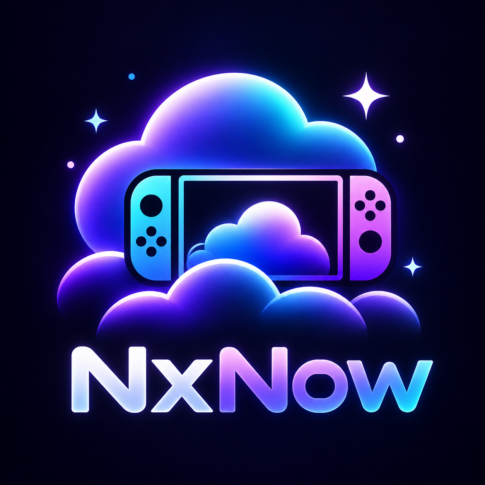
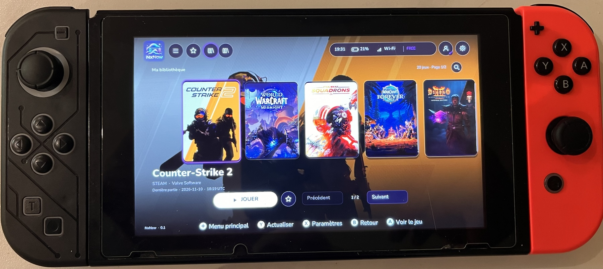
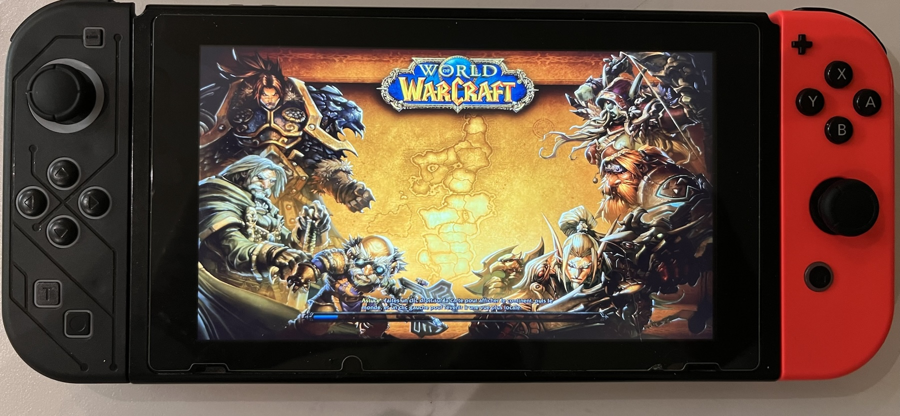
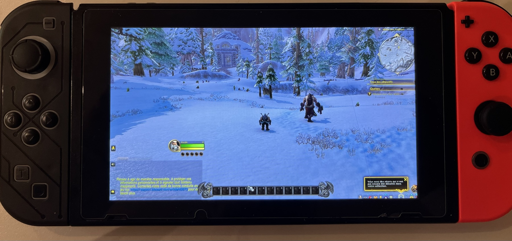
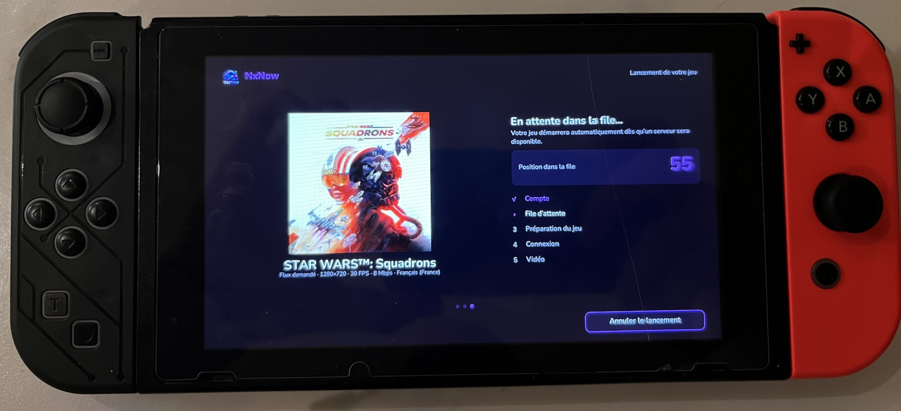
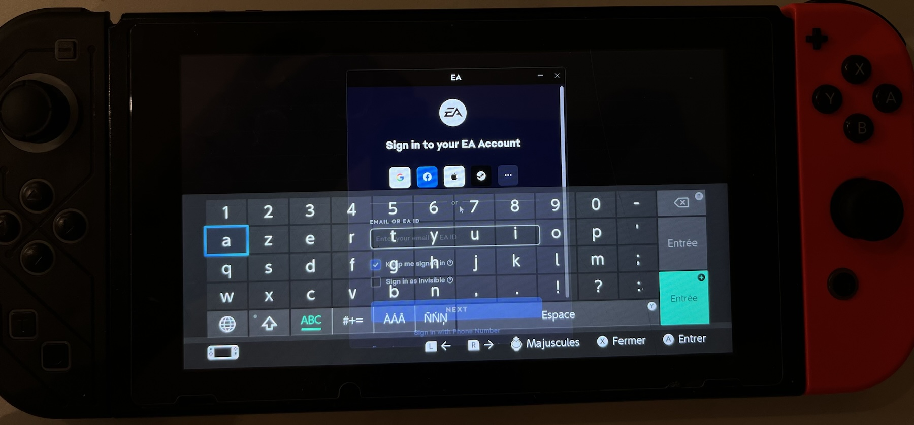

# V0.2b NxNow

### Your PC games. Your Nintendo Switch. Anywhere.

**A fresh way to enjoy GeForce NOW on Nintendo Switch.**

**The best way to play WoW Forever on Nintendo Switch right now! Have fun!**

Beautiful design · Multilingual experience · Controller-first navigation · Cloud gaming on the go

[**Download NxNow**](https://github.com/kazar-root/NxNow/releases) · [**Report an issue**](https://github.com/kazar-root/NxNow/issues) · [**Discover LunaNX**](https://github.com/kazar-root/LunaNX)

---

## What's new in v0.2b

**Small fix for fast-paced games (Counter-Strike 2…).** Since v0.2, a few pictures could stay waiting in line after a network or decoding hiccup, so everything you saw arrived one or two frames late for the rest of the session. NxNow now catches up to the newest picture as soon as such a delay persists, while still smoothing out tiny one-off hiccups. Shooters feel much more responsive again.

> If the stream still stutters and the sound crackles, check your Wi-Fi first: get closer to your router and prefer 5 GHz.

---

## Meet NxNow

**NxNow brings your GeForce NOW gaming experience to Nintendo Switch.** Play compatible PC games from your connected library through an unofficial homebrew client, with an interface carefully designed for the console.

I wanted NxNow to feel like more than a streaming launcher. That's why I've put particular care into the details: a distinctive purple visual identity, smooth controller-friendly navigation, rich game artwork, useful in-game controls, and thoughtful touches throughout the experience. **My goal is simple: give you a cloud gaming experience that feels unique, intuitive, and genuinely enjoyable to use.**

Whether you're exploring your library, launching a game, waiting for a server, or playing, I hope the design and attention to detail will make you smile.

## Why you'll love it

- **Designed for Switch.** A native, purple-themed interface tailored to the console's 720p display, with rich game covers and a clean layout.
- **Multilingual by design.** Console-language-aware UI, including French translation, with localized game descriptions when available from GeForce NOW.
- **Your games in one place.** Browse your GeForce NOW library and catalog, search for titles, organize favorites, and select supported storefronts or launchers.
- **A more personal experience.** Discover free-to-play titles, explore game details, and fine-tune your streaming profile, audio, server, and controls.
- **Made for real gameplay.** Gamepad support, a controller-based mouse and keyboard mode, a Switch virtual keyboard, and USB keyboard/mouse support where available.
- **Helpful little details.** A streamlined sign-in flow using a QR code, animated loading screens, a clear queue experience, and an optional in-game performance HUD.
- **Quick access.** Create a HOME menu shortcut for a game using the built-in shortcut feature, subject to its installation requirements.

**Compatible titles can include games launched through Steam, EA, Battle.net, and other GeForce NOW-supported services.** Game access still depends on your account, game ownership or entitlement, region, and GeForce NOW availability.

## Screenshots

## Get started

1. Download **`NxNow.nro`** or the SD package from the [latest Releases](https://github.com/kazar-root/NxNow/releases).
2. Copy `NxNow.nro` to `sdmc:/switch/NXNow/NxNow.nro`.
3. Launch **hbmenu in application mode** (hold **R** while launching an installed game), then open NxNow. Application mode provides the memory needed for streaming.
4. Connect your Switch to the internet. Select the profile icon in NxNow and scan the QR code using your phone to sign in to NVIDIA.
5. Explore your library or the GeForce NOW catalog, select the appropriate storefront for games you own, and start playing.

NxNow keeps its account-related local data and settings in `sdmc:/switch/NXNow/`. To update, replace the NRO while preserving that folder.

By default, NxNow follows your console language for its interface and requests the same language from GeForce NOW when launching a game. A manual language choice takes priority; the game must support the requested language and may retain its own language settings.

### In-game shortcuts

| Controls | Action |
| --- | --- |
| **L3 + R3** | Switch between gamepad and mouse/keyboard modes |
| **ZR + R3** | Open the virtual keyboard |
| **− and +** | Show or hide the streaming performance HUD |
| **Left stick** (mouse mode) | Move the pointer |
| **ZR / ZL** (mouse mode) | Left / right click |
| **D-pad** (mouse mode) | Keyboard arrow keys |
| **−** (mouse mode) | Escape |

## A project made with passion

NxNow is an independent community project, created by **[KazaR-RooT](https://github.com/kazar-root)**. This is an early release, and your feedback can help make it even better. If you enjoy the app, consider leaving a ⭐ on GitHub or sharing your experience!

Found a bug or have a suggestion? [Open an issue](https://github.com/kazar-root/NxNow/issues). Please include your NxNow version, game, storefront, and steps to reproduce, but never share passwords, access tokens, session files, or console keys.

## Another project: LunaNX 🌙

If you like NxNow, you might also enjoy **[LunaNX](https://github.com/kazar-root/LunaNX)** — my other Nintendo Switch cloud gaming homebrew project, focused on **Amazon Luna**.

**Two different cloud gaming experiences, one shared ambition:** bringing more of the games you love to Nintendo Switch, with interfaces designed specifically for the console.

[**Explore LunaNX on GitHub**](https://github.com/kazar-root/LunaNX)

---

## Acknowledgements & credits

A very special thank-you to **[Blade-Punisher and SwitchNOW](https://github.com/Blade-Punisher/SwitchNOW)**. Without that project, I might never have been inspired to build NxNow.

My thanks also go to the developers of **OpenNOW / OpenCloudGaming** and the open-source communities and maintainers behind **devkitPro, libnx, Deko3D, Borealis, FFmpeg, and libpeer**. Their work and contributions make projects like this possible. All applicable original authorship and copyright notices must be preserved.

And of course, thank you to everyone who tests NxNow, shares feedback, reports bugs, and helps the project grow.

**— KazaR-RooT**

## Licenses & legal notices

NxNow is an **unofficial, independent homebrew application**. It is not affiliated with, endorsed by, or supported by **NVIDIA** or **Nintendo**. GeForce NOW, NVIDIA, Nintendo Switch, and all game titles, logos, and artwork are trademarks or property of their respective owners.

NxNow **does not include or grant games, game licenses, or GeForce NOW subscriptions**. A valid NVIDIA account and applicable service access, game entitlements, storefront accounts, and regional availability are required. Service behavior, queue times, and supported titles may change.

The application's MIT-licensed source code retains the [repository's MIT license](LICENSE), including the original copyright notices and notices for NxNow modifications. Third-party components remain subject to their respective licenses. The bundled FFmpeg build uses `--enable-gpl`; distribution of the combined NRO is subject to the corresponding GPL obligations. **Do not remove original third-party notices or assume the MIT license alone covers every distributed binary.**

Before redistribution, consult [NOTICE.md](NOTICE.md), the [third-party licenses](licenses/), [dependency documentation](docs/DEPENDENCIES.md), and any separate notices for the HOME shortcut installer at `tools/nxnow-forwarder-installer/`.
