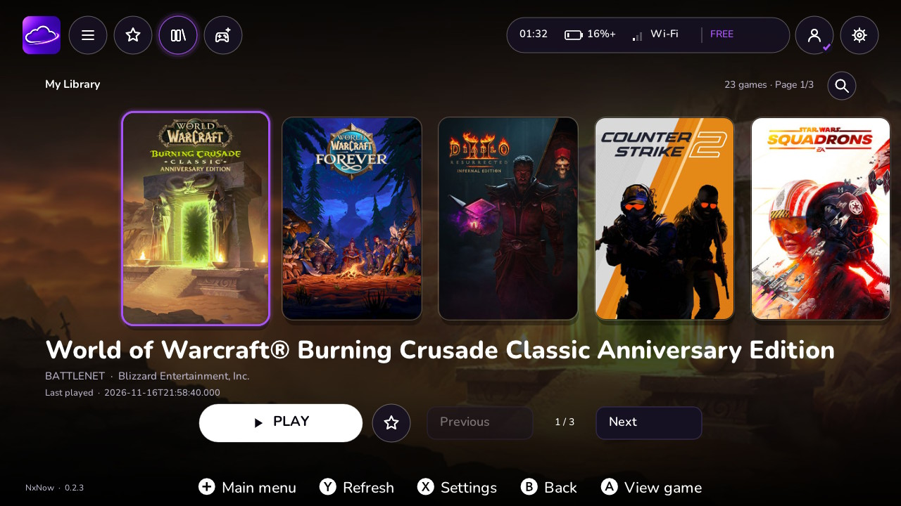
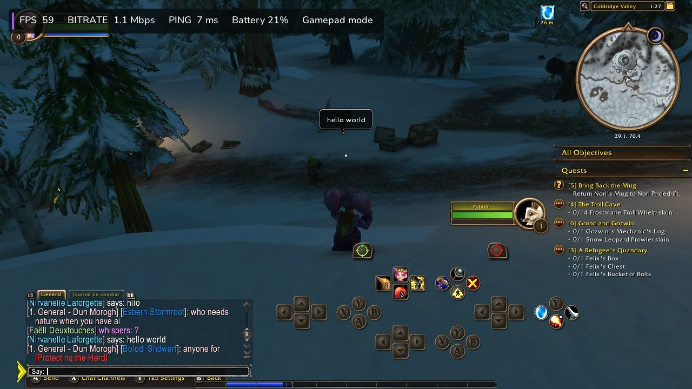
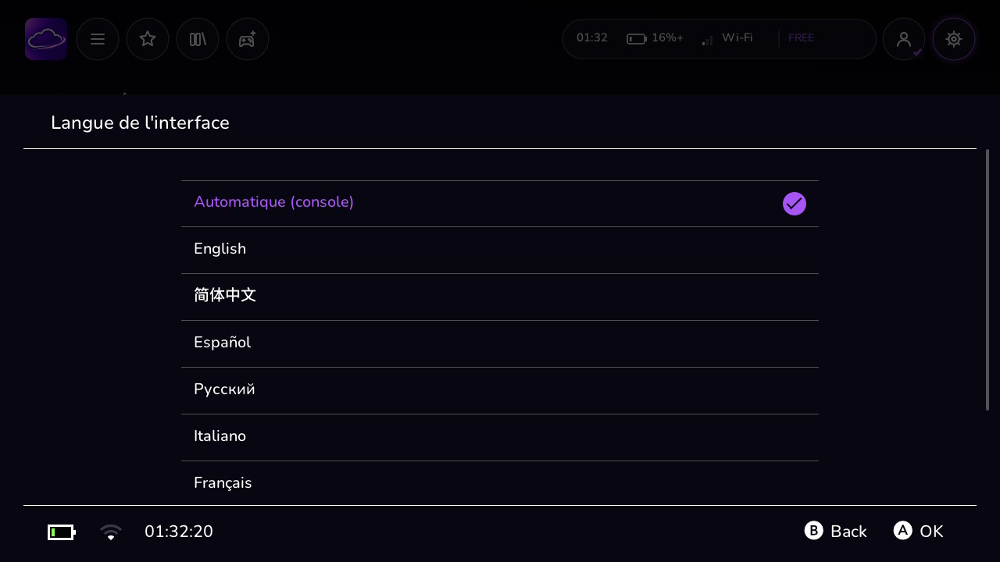

# NxNow v0.2e — New logo and small visual improvements

A small update with a **new logo for the application**, consistent header branding and a cleaner game-launch layout. All v0.2d keyboard and streaming fixes are included.

## What's changed

- **NxNow V3 app icon** for hbmenu, startup/loading, temporary image placeholders and this GitHub page.
- The **NxNow Externe cloud logo** in app headers, including game details, sign-in, game launch and stream status, with **NxNow written in white** in the menu, details, launch and stream-status headers.
- A compact **54 × 54 menu logo**, aligned with the navigation buttons.
- **Long launch titles use at most two lines.** The font adapts when needed; exceptionally long names end in an ellipsis. Instructions, requested settings and cancellation stay clear.

## Play, type and tune your stream

These existing tools remain available in v0.2e:

- **Type text in games and launcher fields:** focus a chat or text field and press **ZR + R3** to open or close the native Switch virtual keyboard.
- **Switch input modes:** press **L3 + R3** to switch between gamepad and mouse/keyboard controls.
- **See live performance:** press **− and + together** to show or hide FPS, bitrate, ping, battery and input mode.
- **Choose your next stream:** adjust profiles, resolution, FPS, bitrate, codec, server location and controls in Settings or the game's Next stream panel. Changes are saved automatically for the next session.
- **Eight interface languages:** English, Simplified Chinese, Spanish, Russian, Italian, French, Polish and Ukrainian, with automatic console-language selection. Game language is configured separately and depends on the game's support.

## Screenshots







[See all eight new screenshots, settings and the Switch keyboard photo](https://github.com/kazar-root/NxNow/blob/v0.2.4/README.md#screenshots).
The supplied captures were taken on 0.2.3, before the final v0.2e header-branding adjustments.

## Installation / update

1. Download **NxNow.nro** below.
2. Replace the existing NRO in **sdmc:/switch/NXNow/**, keeping your account data and settings.
3. Start hbmenu in **application mode** by holding **R** while launching an installed game, then open NxNow.
4. To refresh an existing HOME shortcut's stored icon, reinstall the shortcut from NxNow Settings.

**Release name: v0.2e. App and hbmenu version: 0.2.4.**

The matching application source is available from this release's source-code downloads. The FFmpeg source archive and third-party notices are retained for the bundled dependencies.

Thank you for your feedback and screenshots. Have fun!

— KazaR-RooT

## Integrity

SHA-256 (`NxNow.nro`):

```
72550ab9cd33bcbc46ef14f188d360eb4e2ba4bc5f1e51bf8a6d486a80873b04
```
